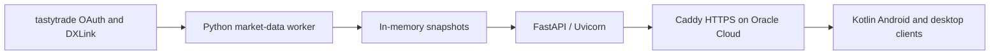

# XspPulse server

XspPulse is a read-only market-data proof of concept. A Python service receives tastytrade DXLink data and exposes the latest in-memory snapshots to a shared Kotlin Multiplatform UI for Android and desktop. It does not implement trading or order management.

The worker subscribes to SPY and active `/ES` futures quotes, and XSP trades. SPY and `/ES` snapshots use quote bid, ask and midpoint; XSP uses the latest trade price for all three fields. The active ES contract is selected from tastytrade futures marked `active_month` on connection. The clients poll the API every two seconds.

The API provides unauthenticated `GET /health` and bearer-key-protected `GET /price/xsp?symbol=SPY|XSP|ES`. A snapshot contains `symbol`, `bid`, `ask`, `mid`, `status`, and `updated_at`. Health indicates the HTTP service is responsive; it does not establish market-data freshness or OAuth health.

## Status and technologies

The proof of concept has been deployed on Oracle Cloud and tested on Windows desktop, an Android emulator, and a physical Sony Xperia 1 V over Wi-Fi and mobile data. On 20 November 2026, all three instruments were reported `STREAMING` with populated prices. This is a learning project, not a production-ready market-data service; see [known limitations](docs/KNOWN_LIMITATIONS.md).

The server uses Python, FastAPI, Uvicorn, Pydantic and the tastytrade SDK. The client uses Kotlin Multiplatform, Compose Multiplatform and Ktor. Caddy terminates HTTPS in front of the server.

- Server: [github.com/SlightlyGone/xsp-pulse-server](https://github.com/SlightlyGone/xsp-pulse-server)
- Android and desktop client: [github.com/SlightlyGone/XspPulseKmp](https://github.com/SlightlyGone/XspPulseKmp)
- [Deployment and operations](docs/DEPLOYMENT.md)
- [OAuth investigation](docs/OAUTH_LESSONS.md)

Run server tests locally with `python -m pytest` in an environment with the packages in `requirements.txt` installed. The client repository documents its own build and key setup.
