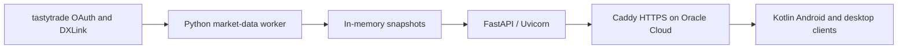

# XspPulse server

XspPulse is a read-only market-data proof of concept. A Python service receives tastytrade DXLink data and exposes the latest in-memory snapshots to a shared Kotlin Multiplatform UI for Android and desktop. It does not implement trading or order management.

The worker subscribes to SPY and active `/ES` futures quotes, and XSP trades. SPY and `/ES` snapshots use quote bid, ask and midpoint; XSP uses the latest trade price for all three fields. The active ES contract is selected from tastytrade futures marked `active_month` on connection. The clients poll the API every two seconds.

The API provides unauthenticated `GET /health` and bearer-key-protected `GET /price/xsp?symbol=SPY|XSP|ES`. A snapshot contains `symbol`, `bid`, `ask`, `mid`, `status`, and `updated_at`. Health indicates the HTTP service is responsive; it does not establish market-data freshness or OAuth health.

## Observation freshness

Each API snapshot read evaluates the time since that instrument's last accepted market-data event. SPY and ES use Quote receipts; XSP uses Trade receipts with a price. Repeated prices count as new observations. Receipt age uses the process's monotonic clock, separately for each instrument; the existing UTC `updated_at` remains the local receipt timestamp for API clients. No JSON fields or types have changed.

| Instrument | Default age threshold | Optional environment variable |
| --- | --- | --- |
| SPY | 120 seconds | `SPY_FRESHNESS_SECONDS` |
| ES | 120 seconds | `ES_FRESHNESS_SECONDS` |
| XSP | 900 seconds (15 minutes) | `XSP_FRESHNESS_SECONDS` |

Thresholds are read when the worker is constructed and must be finite positive numbers. Defaults work without configuration changes. Two minutes gives actively quoted SPY/ES substantial tolerance for brief gaps while revealing a multi-hour stall. XSP trades can be sparse, so its initial tolerance is deliberately longer. These are conservative proof-of-concept choices, not measured service guarantees; tune them using observed event cadence.

While the connection state is `STREAMING`, an instrument reports `WAITING_FOR_DATA` until its first observation, `STREAMING` at or below its threshold, and `STALE` above it. New events restore freshness even when their prices are unchanged. `DISCONNECTED`, `CONNECTING`, `RECONNECTING`, `MISSING_CREDENTIALS` and `STOPPED` take precedence. Reconnecting does not reset observation ages or refresh retained prices. Snapshot reads return copies, so a response cannot change underneath serialization. The worker also exposes `observation_age(symbol)` internally; `None` means no observation yet.

**`STALE` describes observation age only, not a failed DXLink connection.** Freshness reporting is not session-filtered: closures, holidays, ES scheduled breaks, quiet periods and sparse XSP trades can legitimately produce old observations. Do not use `STALE` alone as an outage alert; use `updated_at` to inspect the retained observation and establish whether updates are expected. An absent XSP Trade is not evidence that the shared connection failed. `WAITING_FOR_DATA` likewise makes no failure assertion, even after a long wait.

Local receipt freshness does not prove exchange timestamp freshness, entitlement correctness, OAuth refresh health or a usable price. A cached event delivered after subscribing can look locally fresh. Monotonic ages are in memory, reset on process restart, and are unaffected by wall-clock adjustments; displayed UTC timestamps can still jump with the system clock.

## Optional automatic recovery

Phase 2 adds an opt-in ES inactivity watchdog, **disabled by default**. Set `DXLINK_WATCHDOG_ENABLED=true` at the next intentional service start to enable it. Defaults are 300 seconds of ES inactivity during eligible sessions, a 600-second cooldown between stall decisions, and exponential retry delays from 5 to 300 seconds. Phase 1 freshness thresholds remain independent. `RECOVERING` distinguishes stall recovery from ordinary stale observations; listeners and the old streamer close before replacement.

Disabled mode retains fixed five-second retries and ignores watchdog-only settings. Intentional shutdown is latched so teardown errors cannot restart recovery. Cleanup pending for 30 seconds produces a diagnostic warning while replacement remains blocked.

The DST-aware Chicago schedule excludes routine breaks/weekends and conservatively suppresses holiday windows. **Only 2026 is reviewed; unreviewed years suppress recovery.** An enabled watchdog warns about expired coverage at most once per hour. XSP inactivity never triggers it. Cached/replayed ES receipts can still mask stalled exchange data; exchange-timestamp progression is not implemented. See [watchdog configuration, timing, calendar limitations and rollback](docs/WATCHDOG.md) before enabling it. No deployment or configuration change is implied by adding this feature.

## Status and technologies

The proof of concept has been deployed on Oracle Cloud and tested on Windows desktop, an Android emulator, and a physical Sony Xperia 1 V over Wi-Fi and mobile data. On 20 November 2026, all three instruments were reported `STREAMING` with populated prices. This is a learning project, not a production-ready market-data service; see [known limitations](docs/KNOWN_LIMITATIONS.md).

The server uses Python, FastAPI, Uvicorn, Pydantic and the tastytrade SDK. The client uses Kotlin Multiplatform, Compose Multiplatform and Ktor. Caddy terminates HTTPS in front of the server.

- Server: [github.com/SlightlyGone/xsp-pulse-server](https://github.com/SlightlyGone/xsp-pulse-server)
- Android and desktop client: [github.com/SlightlyGone/XspPulseKmp](https://github.com/SlightlyGone/XspPulseKmp)
- [Deployment and operations](docs/DEPLOYMENT.md)
- [OAuth investigation](docs/OAUTH_LESSONS.md)

Run server tests locally with `python -m pytest` in an environment with the packages in `requirements.txt` installed. The client repository documents its own build and key setup.
